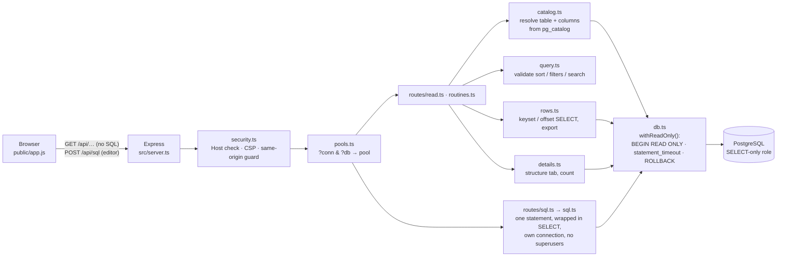

# Architecture

PG Studio is a single Node.js process: an Express server that serves a static front end and a small read-only JSON API. There's no build step for the front end and no client framework.



## Code layout

```
src/
  cli.ts           the `pg-studio` command: flags → environment, then starts server.ts
  server.ts        Express wiring, static files, startup role check
  config.ts        env parsing, connections.json
  pools.ts         one pool per connection, plus on-demand pools for other databases (LRU)
  db.ts            pool + withReadOnly (write pool goes here later)
  catalog.ts       schema/table/column/PK/FK lookups, role privilege check
  routines.ts      functions / procedures / aggregates: list, flags, source, trigger usage
  details.ts       Structure tab (sizes, stats, indexes, constraints, triggers, DDL) and exact count
  query.ts         sort/filter/search: validation and WHERE/ORDER BY building
  rows.ts          builds the SELECT; keyset/offset page fetch, export fetch, CSV/JSON output
  sqltext.ts       SQL editor: scans the text (strings, comments) to count statements and find the first keyword
  sql.ts           SQL editor: runs one wrapped read query, EXPLAIN, export
  security.ts      Host check, CSP headers, same-origin guard for writes
  errors.ts        HttpError + safe PostgreSQL error mapping
  routes/read.ts   /meta, /schemas, /tables, /tables/:name (+ /details, /count, /export)
  routes/connections.ts  /connections, /databases
  routes/routines.ts     /routines, /routines/:oid
  routes/sql.ts          POST /sql, /sql/export (only when SQL_EDITOR is on)
public/
  index.html, app.js, styles.css     the whole UI, no framework, no build
demo/
  docker-compose.yml, seed.sql       throwaway demo database with fake data
scripts/
  smoke-test.sh                      end-to-end API and security checks (used by CI)
```

## How a request is handled

1. **`security.ts`** rejects any request whose `Host` isn't `127.0.0.1:PORT` or `localhost:PORT` (DNS rebinding) and sets a strict CSP and related headers. Non-GET requests also need a same-site `Origin` and an `x-pg-studio: 1` header.
2. **`pools.ts`** turns `?conn=&db=` into a pool. The connection id must be one from the config and the database must be one the role may `CONNECT` to; anything else is a 404 before a pool is created.
3. **`routes/read.ts`** validates numeric parameters and passes the table name to `catalog.ts` **only as a bind parameter** in a `pg_class` lookup. An unknown or unreadable table is a 404.
4. **`query.ts`** checks the sort column and each filter's column against the resolved catalog columns, maps each operator to fixed SQL, and turns every value into a bind parameter (with LIKE wildcards escaped).
5. **`rows.ts`** builds the `SELECT` from catalog identifiers quoted with `pg.escapeIdentifier`, cuts long values inside PostgreSQL, and chooses keyset or offset paging.
6. **`db.ts`** runs everything in `BEGIN TRANSACTION READ ONLY` with a per-transaction `statement_timeout`, and **always rolls back**.
7. **`errors.ts`** maps known PostgreSQL error codes to safe messages and redacts connection strings from anything logged.

The SQL editor takes a different route: **`routes/sql.ts`** accepts a JSON `POST` (so the same-origin guard applies), and **`sql.ts`** checks the text with `sqltext.ts`, refuses superusers, and sends `SELECT * FROM (<text>) AS pgstudio_query LIMIT n` as one statement over the extended protocol, in `withReadOnly` with `SQL_TIMEOUT_MS` and a connection that is discarded afterwards. PostgreSQL errors caused by the query are returned as they are, with the position mapped back into the user's text.

## Design decisions

- **Identifiers come from the catalog, never from the request.** The request names a table or column; the server looks it up and splices in the catalog's spelling, quoted. A table named `x"; DROP TABLE users;--` opens normally.
- **The role is the boundary, not the transaction mode.** `READ ONLY` is a guard rail. A SELECT-only role is the real guarantee, which is why the server checks the role's privileges at startup and the UI turns the badge red if it can write.
- **Text in, text out.** Values travel as PostgreSQL text output, which is also the input format for every type, so a future editor can send back exactly what the grid shows.
- **Bounded everything.** Page size, cell length, export rows and query time all have hard limits.
- **No framework, no build.** The front end is about 2,500 lines of plain JavaScript. That keeps the attack surface small, lets the CSP forbid inline script and style, and means there's nothing to compile.
- **Credentials stay on the server.** Connections come from the environment or `connections.json`. The browser picks one by id and never sees a URL or password, and no endpoint accepts connection details.
- **Code is shown, never run.** Functions and procedures are read from the catalog (`pg_get_functiondef`); nothing calls them.
- **Localhost only.** The bind address isn't configurable. Running PG Studio for other people would need authentication, which is out of scope.

## Known limitations

- **Deep pages are slow with a custom sort.** Sorting by a column uses OFFSET paging, which reads every earlier row. Default-order paging doesn't have this problem. You can't jump to an arbitrary page number in keyset mode; use filters to narrow down instead.
- **Tables without a primary key** are ordered by `ctid` (physical order), so pages can shift while the table changes. The UI warns about this.
- **Row counts are planner estimates** (`reltuples`), shown as `~N`. They're "unknown" until the table has been ANALYZEd. Exact `count(*)` is on demand only. With filters on, no estimate is shown.
- **Filters and sorting on unindexed columns scan the table.** On big tables that can hit the statement timeout, which returns a clear error.
- **Search only covers text and enum columns.** Use a filter for numbers, dates, UUIDs and JSON.
- **CSV has no NULL marker.** NULL is written as an empty cell. Use JSON export if the difference matters.
- **Views have no fixed order.** Paging a view without a sort can overlap or skip rows; the UI says so.
- **The generated DDL is a reading aid**, not a dump: grants, ownership, sequences and partition definitions are left out. Use `pg_dump --schema-only` for a faithful copy.
- **Foreign tables** (`postgres_fdw` and similar) aren't listed, because browsing them queries the remote server.
- **Every value is shown as PostgreSQL text output.** For example, bytea appears as `\x…` hex and timestamps in the server's timezone.
